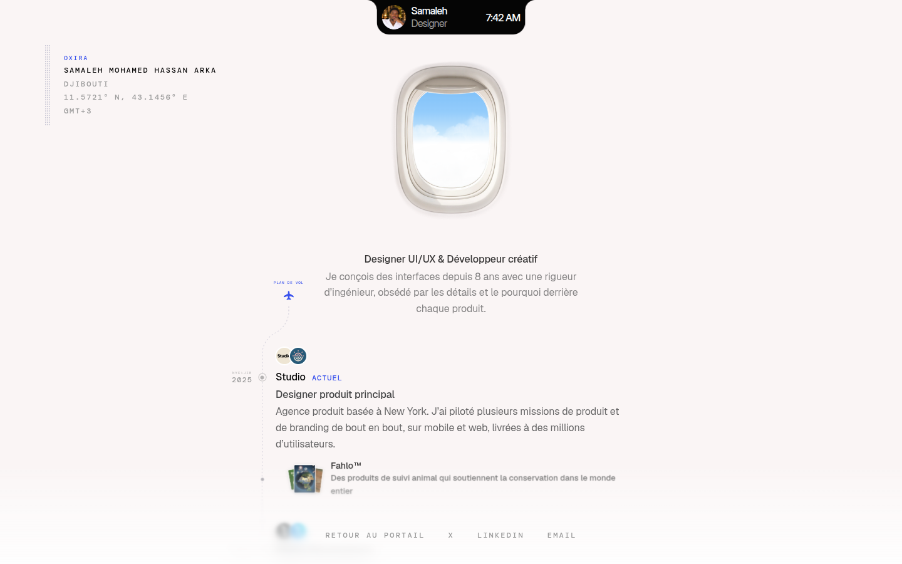
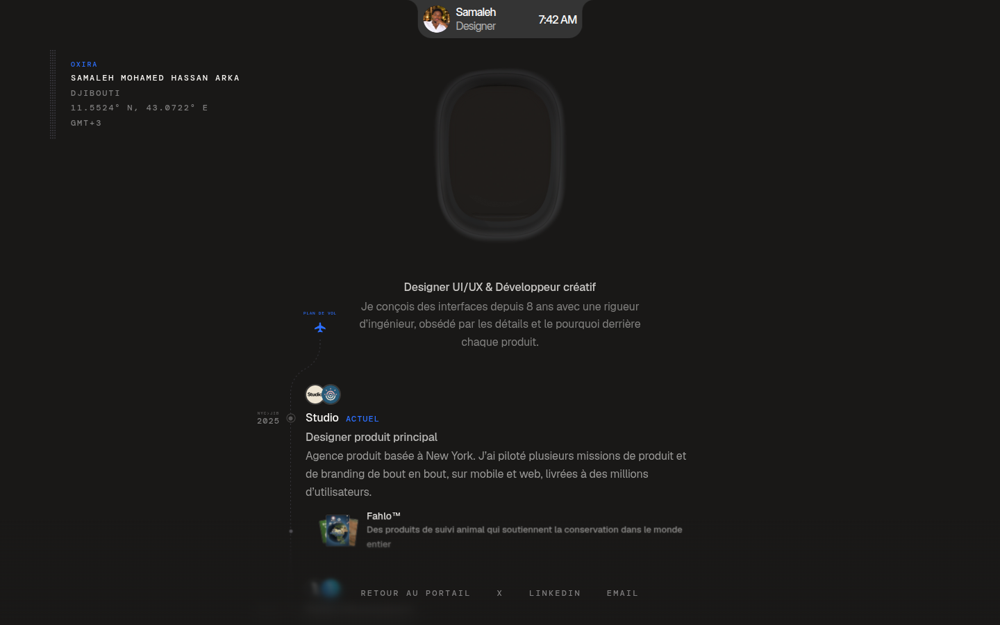
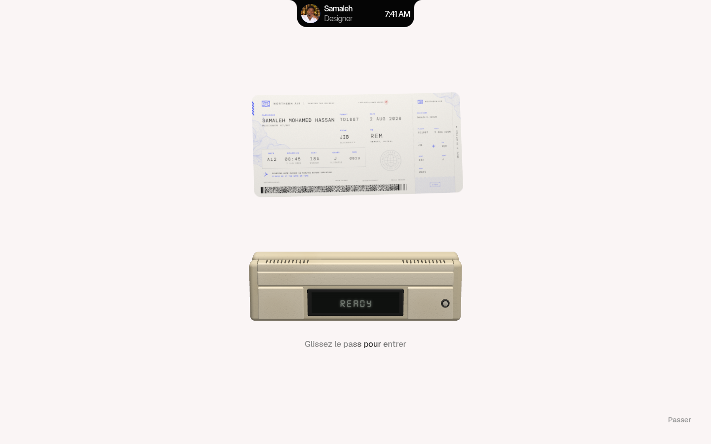
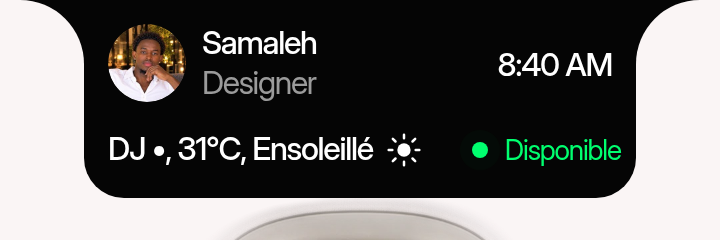
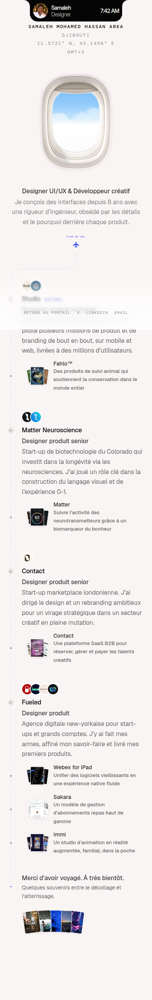

<p align="center">
  
</p>

<h1 align="center">Oxira — Samaleh Mohamed Hassan Arka</h1>

<p align="center">
  <a href="https://hypeer.cloud/"><strong>Live demo</strong></a>
  ·
  <a href="#stack">Stack</a>
  ·
  <a href="#project-structure">Structure</a>
  ·
  <a href="#getting-started">Getting started</a>
</p>

<p align="center">
  
  
  
  
  
</p>

A single-page portfolio (Djibouti) with an aviation-inspired identity: a cabin window with
a draggable shade that switches the whole page to night mode, a 3D boarding-pass
gate, a scroll-linked flight plan and a career timeline.

The interface is built with **React 19 + TypeScript**, bundled by **Vite**,
styled with **Tailwind CSS** and a measured token layer, and animated with CSS
plus two **three.js** scenes (the aircraft window and the boarding-pass reader).

## Highlights

- **Cabin window** — layered WebP frame, animated cloud/water shader, shade
  drag with spring physics; closing it recolours the page to dark.
- **Boarding-pass gate** — swipable 3D card, card reader with LCD states
  (READY / READING / ERROR / SUCCESS), bloom and contact shadows.
- **Flight plan** — SVG path that lights up with scroll, timeline dots that
  pulse as they are reached, responsive curve on mobile.
- **Timeline** — four career stops with company logos, hover lift, project
  thumbnails that fan out on hover.
- **Memories** — a fan of photographs with captions.
- **Fan Carousel** — the Fahlo card opens the live component demo at
  the Fan Carousel demo (5 cards, 3D fan, drag/keys/autoplay) with a back link
  to the portfolio. The demo ships from `ui/public/carousel/`.
- **Dynamic island notch** — a fixed pill at the top (237 x 55 px, opens to
  276 x 99 px) with photo, name, live clock, weather and availability.
  Spring-driven size and shoulder curves, closes on any outside tap, and
  switches to `#343434` in dark mode.
- **Responsive** — 8 tested widths from 360 to 1920 px, dark and light themes,
  reduced-motion and no-WebGL fallbacks.

<p align="center">
  
  
</p>

<p align="center">
  
</p>

<p align="center">
  
</p>

<p align="center">
  
</p>


## Stack

| Layer | Choice |
| --- | --- |
| Framework | React 19 (function components, hooks, Suspense) |
| Language | TypeScript 5 (strict, `.tsx` / `.ts`) |
| Build | Vite 7 |
| Styling | Tailwind CSS 3 with measured theme tokens + a scoped stylesheet for complex visuals |
| 3D | three.js, @react-three/fiber, @react-three/drei, @react-three/postprocessing |
| Motion | CSS keyframes, `requestAnimationFrame` springs, SVG path lighting |

## Project structure

```text
ok/
├── ui/                                  Vite + React 19 + TypeScript application
│   ├── public/                          Static, copied as-is
│   │   ├── carousel/                    Fan Carousel demo (own app + assets)
│   │   ├── theme.js                     Pre-paint colour-scheme restore
│   │   └── favicon.svg · apple-touch-icon.png · icon-*.png · og-image.jpg
│   ├── src/
│   │   ├── app/                         Composition root (App, phase machine)
│   │   ├── sections/                    Page-level layout (Folio)
│   │   ├── components/
│   │   │   ├── boarding-pass/           Gate scene (three.js) + HUD
│   │   │   ├── cabin/                   Window, shade physics, WebGL sky
│   │   │   ├── timeline/                Career rail, project cards, SVG path
│   │   │   ├── memories/                Photograph fan
│   │   │   ├── notch/                   Dynamic-island pill
│   │   │   ├── layout/                  Footer + blur stack
│   │   │   └── splash/                  Boot screen
│   │   ├── content/                     Copy and portfolio data
│   │   ├── config/                      Measured geometry and timings
│   │   ├── hooks/                       useClock, useCountUp
│   │   ├── lib/                         Small helpers (motion)
│   │   ├── styles/                      Tailwind entry + component stylesheets
│   │   ├── assets/                      Fonts, imagery, brand mark
│   │   └── main.tsx
│   ├── eslint.config.js · .prettierrc · .editorconfig
│   ├── tailwind.config.js · postcss.config.js
│   ├── vite.config.ts · tsconfig.json · package.json
│   └── index.html
├── docs/                                Architecture notes and README screenshots
└── README.md
```

## Getting started

```bash
cd ui
npm install
npm run dev        # http://localhost:5173/
npm run build      # production build -> ui/dist
npm run preview    # serve the production build
```

Node 20+ recommended.

## Scripts

| Command | Description |
| --- | --- |
| `npm run dev` | Vite dev server on http://localhost:5173/ |
| `npm run build` | Type-check then bundle to `dist/` |
| `npm run typecheck` | `tsc --noEmit` |
| `npm run lint` | ESLint (flat config, react-hooks) |
| `npm run format` | Prettier over `src` |
| `npm run preview` | Preview the production build |

## Architecture

Feature-first layout: each feature owns its styles, state and animation.
`docs/ARCHITECTURE.md` describes the phase machine, state ownership, styling
and animation strategies, the two 3D scenes and the build/delivery model.

## Engineering notes

- **Real measurements, not defaults** — spacing, type, easing and geometry come
  from computed styles; they live in `styles/folio.css` and `constants.ts`.
- **Accessibility** — semantic landmarks, alt text, keyboard focus for real
  controls, `prefers-reduced-motion` fallbacks, `inert` behind the gate.
- **Performance** — route-free single page, lazy WebGL scenes, self-hosted
  fonts, no analytics, 473 KB gzip JS including three.js.
- **Fallbacks** — no WebGL: static sky artwork; reduced motion: no gateway.

## Build

```bash
cd ui
npm install
npm run build           # -> ui/dist
```

The Fan Carousel demo lives in `ui/public/carousel/` (its own `app.js`,
`app.css` and `assets/`), so `npm run build` copies it to `dist/carousel/`.
It is intentionally kept outside the React bundle.
